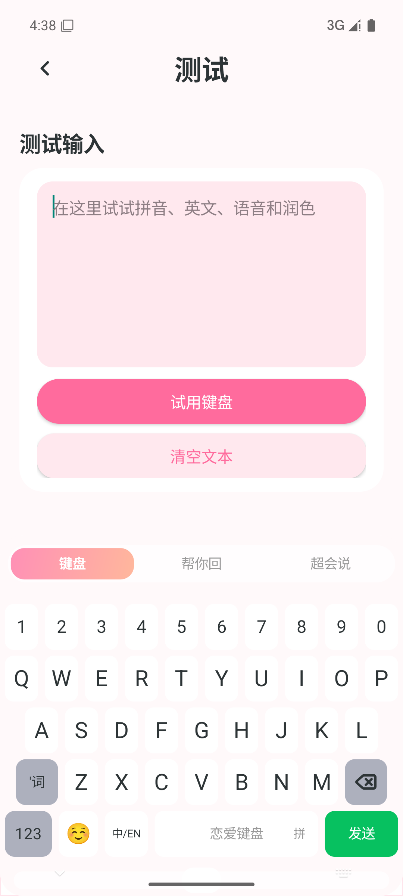
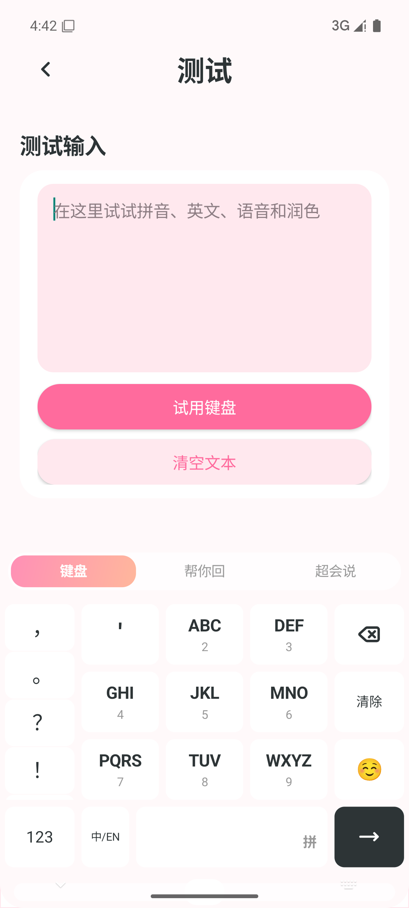
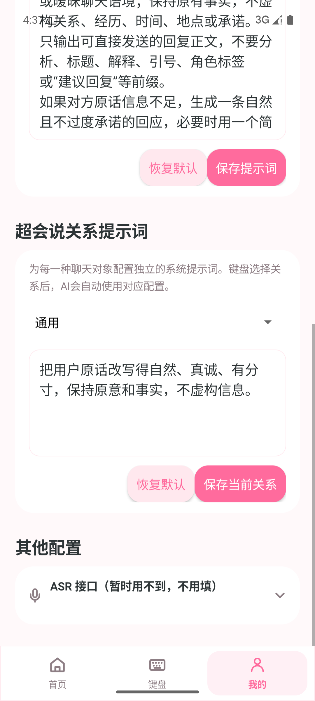

# 恋爱键盘（LianAi Keyboard）

<p align="center"></p>

<p align="center">一款面向 Android 的开源 AI 恋爱输入法：正常打字，也能帮你回、帮你说。</p>

<p align="center">
  <a href="https://lianai.bahuang.tech/h5/">下载最新版</a> ·
  <a href="README.md">English</a> ·
  <a href="LICENSE">GPL-3.0-or-later</a> ·
  <a href="PRIVACY.md">隐私说明</a>
</p>

> 当前源码版本：**v1.6.10**（versionCode 50）。最低支持 Android 10（API 29），当前构建 arm64-v8a 安装包。源码更新与下载渠道发布分别进行，公开安装包以下载页实际提供的版本为准。

## 项目简介

恋爱键盘由“键盘管理 App + Android 输入法”组成。用户可以使用 26 键或九宫格进行离线中文输入，也可以在聊天时调用自己配置的大模型生成三条回复建议、分析对方情绪，或优化自己准备发送的话。

项目不绑定固定模型厂商。文本模型支持 DeepSeek、Kimi、通义千问、豆包、硅基流动等预设，也支持用户填写 OpenAI Chat Completions 兼容接口地址、模型名和 API Key。API Key 使用 Android Keystore 加密保存，不会提交到本仓库。

## 主要功能

- **基础输入法**：26 键拼音、九宫格拼音、英文、数字、符号、Emoji、候选词、删除与光标编辑。
- **帮你回**：粘贴对方的话，分析情绪并生成三条可点击使用的回复；支持重新分析。
- **超会说**：先在键盘内部输入草稿，一键优化为三条备选话术，再选择写入聊天输入框。
- **语音听写**：按住麦克风说话，语音实时转成文字上屏。
- **截图识别回复**：从相册选择聊天截图，AI 读懂对话并生成得体回复。
- **恋爱知识库**：安装包内置干净版「狗头军师知识库」和「童锦程知识库」，本地阅读无需下载；支持自建或导入 Markdown、纯文本文档。
- **关系提示词**：通用、心动对象、恋人、朋友、家人、同事、客户、上司等关系可分别配置系统提示词。
- **多模型配置**：订阅套餐开通官方 AI 通道免配置开箱即用，也可自配厂商、接口类型、API 地址、Key 和模型（兼容接口）。
- **本地优先**：拼音与基础候选离线运行；剪贴板历史、听写历史默认关闭。

## 知识库与默认设置

- **系统知识库**：只能查看、启用/停用、设为默认，不允许编辑或删除。个人导入的同名文档仍属于个人文档，可以编辑和删除。
- **设为默认**：点击文档右侧三个点，选择「设为默认」，列表会标出默认项；该操作同时更新键盘中的选择，若文档已停用则同时启用。首次安装默认选择狗头军师，之后尊重用户的默认设置及键盘手动选择。
- **键盘使用**：「帮你回」面板底部、「超会说」语言切换和麦克风之间显示当前知识库，可随时切换。手动选择「未选择知识库」后不发送资料，此选择会保留。
- **阅读与编辑**：详情直接渲染 Markdown 的标题、加粗、列表、引用、代码、表格和待办项；二级页面隐藏底部导航，系统文档不显示编辑或保存入口。个人文档在查看页可进入编辑。
- **本地缓存**：列表提前准备系统文档的排版结果，并按正文及显示配置缓存；重复打开复用结果，修改个人文档后重新排版。
- **升级保留数据**：更新系统资料时保留启停状态、个人文档和已有选择，不读取营销输入法数据。

帮你回、超会说和截图回复都会引用当前选中文档的有限片段，参考正文预算约 4,800 字符；没有匹配词时提供该文档的开头基础内容，不会把整份知识库全部发给模型。截图回复先取得视觉识别语境，再结合知识库通过回复文本通道生成最终结果，可能产生两次模型调用。资料读取失败会提示，不会静默跳过。来源、调研说明和许可文件不进入知识库参考正文。

知识库阅读与基础打字可离线使用；AI 生成仍需要所选模型服务。完整数据流程见 [隐私说明](PRIVACY.md)，版本变更见 [更新记录](CHANGELOG.md)。

## 界面截图

<p align="center">
  
  
  
</p>

## 安装与使用

1. 前往 [官方下载页](https://lianai.bahuang.tech/h5/) 下载 v1.5.8 APK。
2. 安装后打开“恋爱键盘”，按照首页四步引导启用并切换输入法。
3. 使用已开通的官方模型通道，或进入“我的 → 设置 → 大模型配置”填写自己的厂商、接口类型、地址、模型和 API Key。
4. 在微信、短信或其他应用中点击输入框，切换到恋爱键盘即可使用。
5. 在“知识库”查看两份内置资料，或从右侧菜单设置默认知识库。

ASR 语音接口当前不是必填项，默认折叠；只使用文字键盘、“帮你回”和“超会说”时无需配置。

## 大模型配置示例

以 DeepSeek 为例：选择 DeepSeek 厂商，使用应用预设的官方地址或填写兼容接口地址，模型可填写账号支持的 `deepseek-chat`，最后填写自己的 API Key。

请勿在 Issue、截图或聊天记录中公开 API Key。调用费用和内容政策由你所选择的模型服务商决定。

## 本地构建与测试

环境要求：JDK 17、Android SDK 35、NDK 26.1、Gradle 8.7。

```powershell
$env:JAVA_HOME='C:\path\to\jdk17'
gradle :app:testDebugUnitTest :app:assembleDebug --no-daemon
adb install -r .\app\build\outputs\apk\debug\app-debug.apk
```

真机回归使用独立测试包，不覆盖正式版的账号、模型配置和文档：

```powershell
gradle :app:connectedDebugAndroidTest -PtouchRegression=true --no-daemon
```

测试覆盖知识库迁移、默认选择、系统只读、个人编辑、请求体携带资料、Markdown 缓存，以及普通/敏感输入和触摸操作。发布前仍需检查真实输入框与密码框；流程见 [CONTRIBUTING.md](CONTRIBUTING.md)。

仓库提交 Android App 及配套资源；`admin/` 本地管理和支付工程、运行数据、密钥、签名文件、APK 及私人真机截图均不纳入提交。

公开发布前运行 `gradle verifyOpenSourceRelease lintDebug --no-daemon`。

## 隐私与安全

- 密钥由 Android Keystore 保护，不写入源码、构建参数或日志。
- 拼音词典和基础候选在本机运行。
- 只有主动点击 AI 功能时，相关文本才会发送到用户配置的模型接口。
- 请勿在密码、验证码、银行卡等敏感输入框中使用 AI 功能。
- 完整数据边界见 [PRIVACY.md](PRIVACY.md)，安全问题请参照 [SECURITY.md](SECURITY.md)。

## 开源许可与致谢

本项目基于 Vertick IME 进行二次开发，并使用 Trime/librime、Rime-Ice、cppjieba、Lucide 等开源项目。项目依据 [GNU GPL v3 or later](LICENSE) 开源；第三方项目、版本及许可证详见 [THIRD_PARTY_NOTICES.md](THIRD_PARTY_NOTICES.md)。

欢迎提交 Issue、功能建议和 Pull Request。二次分发或修改时，请继续遵守 GPL 及第三方组件许可证。

## 开发者与交流

开发者：**邝广元（广东 · 深圳）**

欢迎扫码添加微信好友，交流使用体验、功能建议或参与开发。

<p align="center"></p>


## 随缘打赏

如果这个项目对你有帮助，欢迎随缘打赏。打赏完全自愿，不影响软件功能、更新或开源许可。

<p align="center"></p>

---

请只从本项目官方 GitHub/Gitee 仓库或官方下载页（https://lianai.bahuang.tech/h5/）下载 APK，并在安装前核对公布的 SHA-256。
